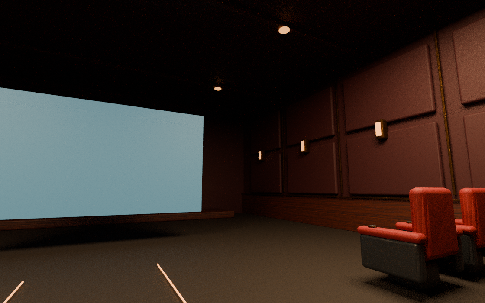
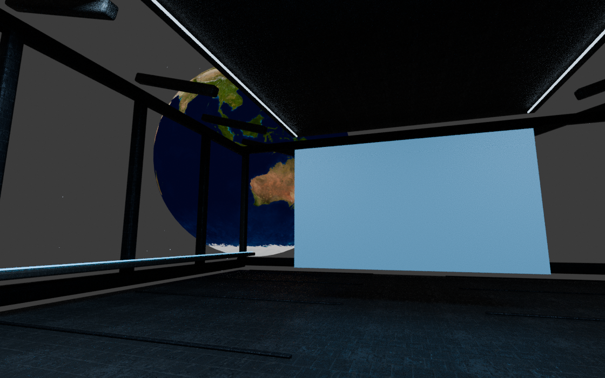

# FongMi Quest VR 影院

面向 Meta Quest 3 / Quest 3S 的沉浸式大屏影院原型，基于 FongMi 项目开展适配。

**当前可安装的测试版是独立影院伴侣，需要配合官方 FongMi 使用；完整 FongMi 一体化版本尚未完成。未进行 Quest 3 真机验收。**

## 下载与使用

在 [Releases](https://github.com/longye45/fongmi-quest-vr/releases) 下载 `fongmi-quest-cinema-debug.apk`，开启 Quest 开发者模式后，通过 Meta Quest Developer Hub 或 ADB 侧载安装。

在官方 FongMi 中开始播放，进入 **播放设置 → 播放器 → 其它 → FongMi VR 影院**。也可以单独启动影院，输入视频直链或选择本地视频。

- 两套真实三维场景：私人影院（红色绒布座椅、地毯、木饰面）与太空观景舱（金属甲板、舷窗、NASA 地球纹理）。
- 0–100% 环境灯光调节、暖色/冷色场景照明、动态阴影开关及随视频变色的屏幕泛光开关。
- 场景、灯光、阴影、泛光设置持久保存；启动页提供无需视频的“预览影院场景”入口。
- 固定于空间的大屏，手柄射线操作。
- 调整屏宽（3–10 米）与距离（3–12 米），保存设置。
- 播放/暂停、前后 10 秒，系统菜单失去焦点时暂停。
- 接收 FongMi 的视频地址、HTTP 请求头及起播进度。
- 独立版本使用 Media3，支持 MP4、HLS、DASH 和本地视频，实际编码支持依赖设备。

[完整安装说明及限制](quest-player/README.md) · [开发与验证记录](QUEST.md)

## 场景预览

以下为同一套模型的 Blender 离线渲染，使用占位屏幕，不是 Quest 实机截图。




使用 1K PBR 材质，影院约 4.6 万三角形，观景舱约 2.4 万三角形；最多两盏灯投射动态阴影。实际帧率与阴影质量须用头显验证。素材来源和生成方法见 [ASSET_CREDITS.md](ASSET_CREDITS.md)。

## 代码结构

| 路径 | 状态 |
| --- | --- |
| `quest-player/` | 可单独构建的影院伴侣，包名 `com.fongmi.quest.cinema` |
| `app/src/quest/` | 一体化变体的影院代码，以及两种版本共享的布局与状态逻辑 |
| 根目录 FongMi 工程 | 新增 `quest` 变体，仍需补齐配套播放器 AAR 才能完成构建 |

独立版本构建（JDK 21、Android SDK Platform 37.0）：

```sh
cd quest-player
./gradlew :app:assembleDebug :app:testDebugUnitTest :app:lintDebug
```

## 已有验证

独立版本编译成功；12 项单元测试通过；Android Lint 无错误；APK 签名及对齐验证通过。测试包仅包含 ARM64 原生库，minSdk/targetSdk 为 34。尚未验证 Quest 3 上的安装、渲染、控制器和 FongMi 跨应用交接。

当前未实现曲面、SBS/TB 立体电影、180°/360°、透视或手势追踪。独立影院不继承官方定制 FFmpeg/mpv、外挂字幕、弹幕或 DRM 授权能力。

## 上游与许可

上游：[FongMi/TV](https://github.com/FongMi/TV)，基线提交 `b49b7027639edd42c7209651f9f0dab7150ae7ba`（源码 5.6.3）。原始说明保留在 [README.upstream.md](README.upstream.md)，许可证见 [LICENSE.md](LICENSE.md)。本仓库为第三方适配原型。
