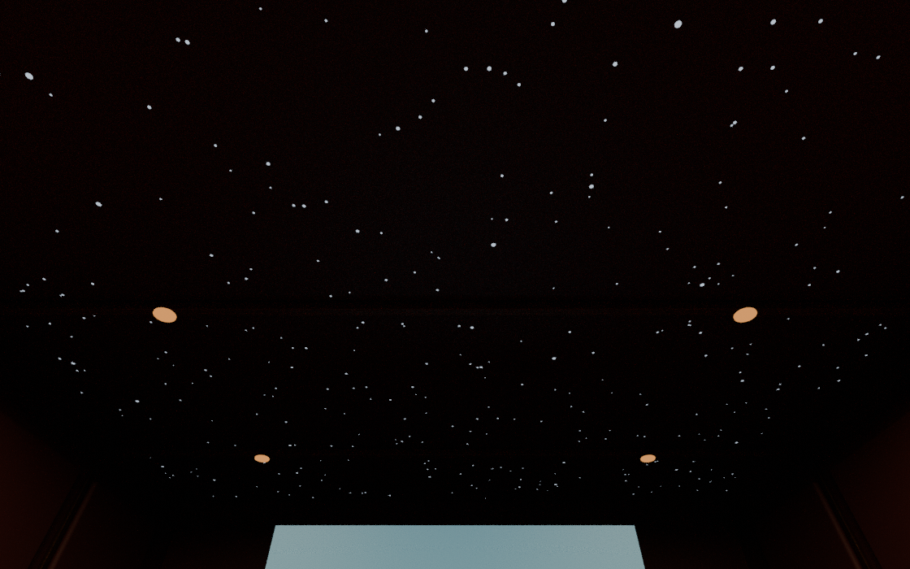

# FongMi Quest VR 一体化影院

面向 Meta Quest 3 / Quest 3S 的 **单 APK**：在同一个应用中配置片源、浏览选片、解析播放、进入 VR 影院以及切换剧集。无需另装官方 FongMi 作为播放器入口。

当前为 `1.1.0-alpha.1` 一体化测试版，基于 FongMi 公开源码 5.6.3；它不是官方闭源依赖发行包 5.7.7 的完整同步版。尚未连接 Quest 3 进行实机验收。

## 安装与使用

从 [1.1 测试版发布页](https://github.com/longye45/fongmi-quest-vr/releases/tag/v1.1.0-alpha.1) 或 [固定版本 APK](https://raw.githubusercontent.com/longye45/fongmi-quest-vr/3955fca775cd52d3f89b94e350ed1a8c916c2de3/fongmi-quest-integrated-debug.apk) 下载一体化安装包，在 Quest 开启开发者模式后通过 Meta Quest Developer Hub 或 ADB 安装。

```sh
adb install -r fongmi-quest-integrated-debug.apk
```

包名 `com.fongmi.quest.cinema`，versionCode `1001`，沿用此前 0.3.0 影院测试版的 debug 签名，可以覆盖安装并保留影院、灯光、星空顶偏好。第一次使用一体化浏览器时，需要在本应用中添加自己的片源配置；不自动读取其他应用的数据。

1. 启动 **FongMi VR 影院**，在应用设置中添加自己的配置。
2. 在本应用内选片并开始播放，点击播放器中的 **VR 影院** 按钮。
3. 在影院控制面板的 **选集与线路** 页中选择线路与任意剧集，每页 16 集，当前剧集高亮；或选择 **上一集 / 下一集**；**自动连播**默认开启，可独立关闭，设置会保存。下一集由同应用内原来的解析流程加载，影院 Activity 与房间保持打开。
4. 躺好后点击 **躺看 / 回正**，在 3 秒倒计时内看向希望放置银幕的方向；影院、银幕和控制面板一起定位并固定，不随头部持续移动。升高、降低与倾角可单独调整，**重置位置**恢复正向默认布局。
5. 两个场景分别保存屏宽、距离、高度、倾角、回正姿态、灯光、阴影、画面光和星空设置。重新进入时以本次头显位置与水平朝向恢复保存的俯仰/侧倾，避免恢复过期的地面坐标；换坐姿后可再次回正。
6. 返回后继续在同一应用选片。首页底部 **影院预览** 可在没有视频时查看场景、调位置和灯光。

不内置内容来源。剧集切换需要配置返回有效的剧集列表与可解析地址；单个直链或本地文件没有凭空生成的下一集。

## 影院与光影

- 私人影院：红色绒布座椅、地毯、木饰面、620 个光纤灯点的星空顶。
- 太空观景舱：金属甲板、舷窗及 NASA 地球纹理。
- 环境灯亮度、动态阴影、屏幕取色照明、星空顶开关与亮度独立设置，并按场景分别保存；旧版全局偏好迁移到其最后使用的场景。
- 世界空间大屏，屏宽 3–10 米、距离 3–12 米，支持延时回正、躺看、高度及 ±20° 倾角调整；手柄射线操作，失去 VR 焦点时暂停并取消待执行的回正。

以下为 Blender 离线模型预览，不是 Quest 实机截图。





素材与生成方法见 [ASSET_CREDITS.md](ASSET_CREDITS.md)。

## 可复现构建

需要 JDK 21、Android SDK Platform 37.0、Python 3.10 和 Git。Gradle wrapper 已包含。

```sh
python tools/bootstrap-media3.py
# 根目录 local.properties 写入自己的 sdk.dir，不要提交本机路径或签名密钥。
./gradlew -PbuildPython=/path/to/python3.10 :app:assembleQuestDebug :app:testQuestDebugUnitTest :app:lintQuestDebug
```

输出：`app/build/outputs/apk/quest/debug/` 下的 ARM64 APK。

播放器直接从作者的公开 [Media3 定制分支固定提交](https://github.com/FongMi/media/tree/3c2cbe8ac742c2fe15eff52f03eeb3b1b648848d) 构建，不从官方 APK 提取或伪造 AAR。`quest-media3/` 和 `tools/media3/` 提供构建适配，源码下载至忽略的 `.deps/media3/`。

公开 Media3 分支缺少后续 libass 接口，因此本版本使用兼容的基础字幕接口；没有包含 libass 或构建 Exo 的 FFmpeg JNI 软解桥接。保留公开分支提供的 mpv 及其 FFmpeg 共享库。不要将编译成功视为所有字幕、解码器、格式和 DRM 场景均已验收。

## 项目状态

| 路径 | 用途 |
| --- | --- |
| 根工程 `app` 的 `quest` 变体 | 当前单 APK 一体化版本 |
| `app/src/quest/` | VR 场景、影院控制与同进程播放器显示 |
| `quest-media3/`、`tools/media3/` | 固定版本的公开播放器源码构建适配 |
| `quest-player/` | 0.3.0 及以前的独立影院伴侣原型，保留作为历史代码 |

已完成构建、单元测试、应用 Lint、APK 签名与对齐校验；换集和渲染仍待 Quest 3 实测。完整技术说明、验证结果与真机验收清单见 [QUEST_INTEGRATED.md](QUEST_INTEGRATED.md)。早期开发记录见 [QUEST.md](QUEST.md)。

## 上游与许可

上游 [FongMi/TV](https://github.com/FongMi/TV)，公开源码基线 `b49b7027639edd42c7209651f9f0dab7150ae7ba`。这是第三方 Quest 适配。原始说明见 [README.upstream.md](README.upstream.md)，许可证见 [LICENSE.md](LICENSE.md)。播放器及原生库来源记录同时嵌入 APK 的 `assets/third_party/`。
